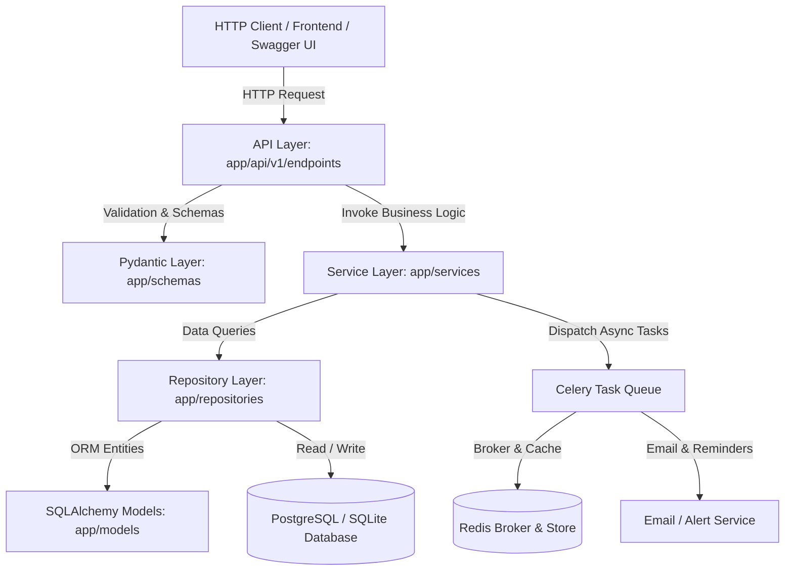

# WorkFlow Pro — Task & Project Management REST API

[](https://www.python.org/downloads/)
[](https://fastapi.tiangolo.com/)
[](https://www.sqlalchemy.org/)
[](https://www.postgresql.org/)
[](https://www.docker.com/)
[](LICENSE)

A high-performance, secure, multi-tenant project and task management backend built with **Python 3.12+**, **FastAPI**, **SQLAlchemy 2.x**, **PostgreSQL**, **Alembic**, **JWT + Argon2**, **Redis**, and **Celery**.

---

## 🏗️ Architecture & System Design

WorkFlow Pro uses a **Layered Clean Architecture** that enforces a strict separation of concerns across API routing, request validation, business rules, persistence, and background tasks:



### Architectural Layer Responsibilities
- **`app/api/`**: Receives incoming HTTP requests, enforces JWT authentication, handles HTTP status codes, and delegates execution to services.
- **`app/schemas/`**: Pydantic models for strict input validation, type coercion, and JSON response serialization.
- **`app/services/`**: Encapsulates all domain rules (e.g. status transition constraints, deadline checks, workspace permission boundaries).
- **`app/repositories/`**: Database persistence layer using SQLAlchemy 2.0 ORM expressions, joins, and aggregates.
- **`app/models/`**: Declarative relational tables with foreign keys, unique constraints, and indices.
- **`app/workers/`**: Asynchronous task workers and periodic deadline cron jobs powered by Celery & Redis.
- **`app/core/`**: Central configuration (`pydantic-settings`), Argon2 hashing, and JWT security utilities.

---

## ✨ Features

### 1. Authentication & Role-Based Access Control (RBAC)
- **Password Security**: Argon2id password hashing with memory and parallelism tuning.
- **JWT Authentication**: Short-lived access tokens (1 hour) and long-lived refresh tokens (7 days).
- **Hierarchical Roles**: `Admin`, `Project Manager`, and `Member`.
- **Workspace-Level Isolation**: Users can only access data within workspaces where they hold active membership.

### 2. Workspace & Collaboration Management
- Multi-tenant workspace architecture with ownership tracking.
- Invite and manage workspace collaborators with tailored workspace roles.
- Default personal workspace auto-generated upon user registration.

### 3. Project Management & Dynamic Progress Tracking
- Create and organize projects with status management (`planning`, `in_progress`, `completed`, `on_hold`, `cancelled`).
- **Dynamic Completion Percentage**: Real-time progress calculated as `(completed_tasks / total_tasks) * 100`.

### 4. Advanced Task Management
- Full CRUD for tasks with priorities (`low`, `medium`, `high`, `urgent`) and statuses (`todo`, `in_progress`, `in_review`, `completed`, `blocked`).
- **State Transition Guards**: Validates permitted lifecycle flows (e.g., prevents invalid jumps; allows reopening).
- **Deadline Enforcement**: Rejects past deadlines for new tasks.
- **Filtering & Search**: Multi-field query filtering by status, priority, assignee, due date ranges, and title/description search.
- **Pagination & Sorting**: Safe limit/offset pagination with customizable sorting order.

### 5. Background Processing (Celery & Redis)
- Asynchronous task assignment notification emails dispatched to assignees.
- Periodic **Celery Beat** worker scanning for approaching deadlines within 24 hours.
- **Graceful Fallback**: Automatically operates seamlessly without Redis during local testing or standalone development.

### 6. Analytics, CSV Export & Audit Logging
- **Productivity Dashboard**: Summarizes completed, pending, and overdue tasks with completion rates and breakdowns.
- **CSV Data Export**: Instant download of all accessible tasks formatted for spreadsheet analytics.
- **Immutable Audit Trail**: Tracks who created, modified, or deleted entities with exact before/after field changes.

---

## 📋 API Endpoints Reference

| Method | Endpoint | Description | Auth Required |
|:---|:---|:---|:---:|
| **POST** | `/api/v1/auth/register` | Register new user & provision default workspace | No |
| **POST** | `/api/v1/auth/login` | Authenticate user & retrieve access + refresh tokens | No |
| **POST** | `/api/v1/auth/refresh` | Renew access token using refresh token | No |
| **GET** | `/api/v1/auth/me` | Retrieve profile of the currently logged-in user | Yes |
| **POST** | `/api/v1/workspaces/` | Create a new workspace | Yes |
| **GET** | `/api/v1/workspaces/` | List accessible workspaces with stats | Yes |
| **GET** | `/api/v1/workspaces/{id}` | Get workspace details and project/member counts | Yes |
| **PATCH** | `/api/v1/workspaces/{id}` | Update workspace name or description | Yes (Admin) |
| **DELETE**| `/api/v1/workspaces/{id}` | Delete workspace and all associated projects | Yes (Owner) |
| **POST** | `/api/v1/workspaces/{id}/members` | Add/invite member to workspace with role | Yes (Admin) |
| **GET** | `/api/v1/workspaces/{id}/members` | List members of workspace | Yes |
| **DELETE**| `/api/v1/workspaces/{id}/members/{uid}` | Remove member from workspace | Yes (Admin) |
| **POST** | `/api/v1/projects/` | Create a project in an accessible workspace | Yes (Manager+) |
| **GET** | `/api/v1/projects/` | List accessible projects (filter by workspace, status) | Yes |
| **GET** | `/api/v1/projects/{id}` | Get project details & dynamic completion % | Yes |
| **PATCH** | `/api/v1/projects/{id}` | Update project details or status | Yes |
| **DELETE**| `/api/v1/projects/{id}` | Delete project and cascaded tasks | Yes |
| **POST** | `/api/v1/projects/{id}/tasks` | Directly create a task under project | Yes |
| **POST** | `/api/v1/tasks/` | Create a task with priority, deadline, assignee | Yes |
| **GET** | `/api/v1/tasks/` | Multi-filter, paginate, search, and sort tasks | Yes |
| **GET** | `/api/v1/tasks/{id}` | Get detailed task information & overdue flag | Yes |
| **PATCH** | `/api/v1/tasks/{id}` | Update task status, deadline, or assignee | Yes |
| **DELETE**| `/api/v1/tasks/{id}` | Delete task and record audit entry | Yes |
| **GET** | `/api/v1/reports/summary` | Get productivity summary & status breakdown | Yes |
| **GET** | `/api/v1/reports/export/csv` | Download tasks report as CSV file | Yes |
| **GET** | `/api/v1/reports/audit-logs` | Retrieve paginated audit history logs | Yes |
| **GET** | `/health` | System health and environment check | No |

---

## 🚀 Quickstart & Local Setup

### 1. Clone & Environment Setup

```bash
# Clone the repository
git clone <repository-url>
cd workflow-pro

# Create and activate virtual environment
python -m venv .venv

# On Windows (PowerShell):
.\.venv\Scripts\Activate.ps1

# On Linux / macOS:
source .venv/bin/activate

# Upgrade pip and install dependencies
pip install --upgrade pip
pip install -e .
pip install -e ".[dev]"
```

### 2. Environment Variables

Copy the sample environment file:
```bash
cp .env.example .env
```
*(By default, `.env` is configured to use local SQLite for immediate zero-config startup).*

### 3. Database Migrations

Apply database schema migrations via Alembic:
```bash
python -m alembic upgrade head
```

### 4. Run the API Server

```bash
uvicorn app.main:app --reload --host 127.0.0.1 --port 8000
```

Access the interactive API documentation:
- **Swagger UI**: [http://127.0.0.1:8000/docs](http://127.0.0.1:8000/docs)
- **ReDoc**: [http://127.0.0.1:8000/redoc](http://127.0.0.1:8000/redoc)
- **Health Check**: [http://127.0.0.1:8000/health](http://127.0.0.1:8000/health)

---

## 🧪 Automated Testing

The automated test suite runs with **Pytest**, **HTTPX**, and an isolated in-memory SQLite database:

```bash
python -m pytest -v
```

All 26 test suites cover:
- User registration, duplicate email rejection, short password validation.
- Login credential verification and JWT token expiration/refresh flow.
- Workspace membership and cross-workspace access isolation.
- Project creation permissions and real-time completion percentage calculations.
- Task deadline validation, state transition integrity, and priority/status filtering.
- CSV report generation and change audit logging.

---

## 🐳 Docker & Multi-Container Deployment

Run the complete multi-service environment (FastAPI, PostgreSQL 16, Redis 7, Celery Worker, and Celery Beat) using Docker Compose:

```bash
# Start all containers in the background
docker compose up -d --build

# View container logs
docker compose logs -f api

# Stop all services
docker compose down
```

---

## 💼 Interview & Technical Discussion Guide

### Core Backend Concepts Demonstrated:
1. **Separation of Concerns**: How the layered architecture (API -> Service -> Repository -> Model) makes the codebase maintainable and testable without tightly coupling endpoints to database logic.
2. **Authentication vs. Authorization**: Authentication identifies who the user is via Argon2 password verification and JWT claims; authorization validates permissions through workspace roles and RBAC dependencies.
3. **Optimized Database Queries**: Preventing N+1 queries through SQLAlchemy relationship eager loading, subquery row counting, and foreign key cascading.
4. **State Machine Modeling**: Preventing illegal state transitions (e.g. jumping between disjoint task lifecycle states) by validating transitions inside the Service domain layer.
5. **Asynchronous Background Processing**: Offloading slow I/O operations (email notifications and deadline tracking) to Celery workers backed by Redis, ensuring sub-50ms API response times.
